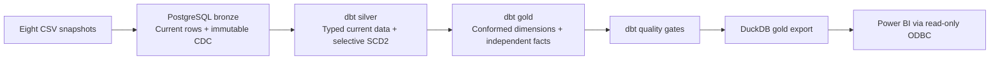

# Olist retail analytics

A reproducible analytics engineering project that turns Olist CSV deliveries into
a dimensional model for Power BI. It demonstrates snapshot change detection,
selective historical tracking, tested fact enrichment and atomic publication
to an embedded analytical database.

The model supports order volume, item sales, freight, payment methods, customer
geography, product mix, seller performance and review analysis. Monetary values
are source amounts; the project does not claim to calculate recognized revenue,
refunds or profit.

## Architecture



| Layer | Responsibility |
|---|---|
| Python ingestion | Validate a complete delivery, compare keys/hashes, commit inserts/updates/deletes atomically |
| PostgreSQL bronze | Keep source change evidence and batch lineage |
| dbt silver | Apply types, Type 1 corrections and selected SCD2 attributes; create a unique order-context lookup |
| dbt gold | Publish facts at explicit grains with direct dimension keys |
| DuckDB | Serve a portable, typed copy of tested gold tables |
| Power BI | Relationships, business measures and presentation |

See [modeling decisions](docs/modeling.md) for grains, SCD rules and temporal
limitations, and [Power BI setup](docs/power-bi.md) for the relationship matrix.

## Modeling decisions

- **Independent facts:** items, payments and reviews receive customer/date/status
  context through a one-row-per-order lookup. They do not require fact-to-fact
  relationships in Power BI.
- **Selective SCD2:** customer/seller location and product category retain versions.
  Other non-key dimension attributes use Type 1 updates across all versions.
- **Current transactional facts:** price, payment, status and review corrections
  overwrite their analytical state. Bronze still records every source change.
- **Controlled grain:** tests verify unique keys, unchanged row sets and unchanged
  measures after enrichment. Payments and items are never joined at raw grain.
- **Stable attribution:** a price/status correction does not move an existing
  fact onto a newly observed dimension version.
- **Explicit missing context:** left joins preserve orphan facts with NULL
  dimension keys; a warning test makes them visible.
- **Portable serving:** DuckDB is written separately and published only after
  transformation and error-level data tests succeed.

The source is the [Brazilian E-Commerce Public Dataset by Olist](https://www.kaggle.com/datasets/olistbr/brazilian-ecommerce).
The dataset is a historical extract, not a live feed. Integration tests create
controlled subsequent deliveries to demonstrate changes, deletes and reinsertions.

## Run locally

Requirements: Docker Desktop with Linux containers, and the eight Olist CSVs in
`data/`. For an Ubuntu/WSL terminal, enable Docker Desktop's WSL integration.

From `dbt_project_olist`:

```bash
cp .env.example .env
docker compose build pipeline
docker compose up -d --wait postgres
docker compose run --rm pipeline
```

Use `Copy-Item .env.example .env` in PowerShell. Only copy the example on first setup.
The default local database is `olist`, user `olist`, password `olist_local`,
exposed on `localhost:5433`. Configure different values in `.env`. PostgreSQL has a 1 GB shared-memory allowance for concurrent analytical joins; `docker compose up -d --wait postgres` applies this setting to an existing container while retaining its data volume.

The output is `output/olist.duckdb`: five dimensions, four detailed facts, the
`daily_sales` aggregate fact, and `export_metadata` with the publication batch/time.
The named PostgreSQL volume persists CDC across restarts.

For another complete delivery, replace the CSVs and run:

```bash
docker compose run --rm pipeline
```

Rebuild the pipeline image after changing project code. Containers use a copied
project, not a live source mount. Stop services with `docker compose down`;
deleting the PostgreSQL volume also deletes source history.

### Delivery contract

Supply all eight datasets with their original headers. Both
`olist_resellers_dataset.csv` and `olist_sellers_dataset.csv` are accepted,
but not simultaneously. Keep the delivery unchanged while ingestion runs.

Missing files, conflicting keys, malformed rows and header-only snapshots fail
the whole load. Exact duplicates collapse. Intentional empty snapshots require
`python -m pipeline.run --allow-empty` as the container command.
A truncated but otherwise valid snapshot cannot be distinguished from real deletes.

### Upgrading from the earlier model

Run the standard build/run commands above against the existing PostgreSQL volume.
dbt reconstructs dimensions from retained bronze CDC under the new SCD policy.
Old Type 1-only dimensional versions collapse; therefore **refresh all imported
Power BI tables together**, and recreate relationships using the new keys.

The five obsolete silver history tables may remain in an existing database after a
successful build. They are no longer referenced or maintained; this upgrade does not delete them. Bronze history is retained.
New facts expose `source_event_id` for lineage instead of the former fact
`version_id`; dimension `version_id` remains the relationship key.
The new date-only and customer/status columns are described in the Power BI guide.

## Validation

```bash
docker compose run --rm pipeline python -m pytest tests/test_pipeline.py -q
```

Tests create and drop uniquely named disposable databases; they do not reset the
application database. The configured local role must have CREATEDB.

Coverage includes initial and unchanged loads, update/delete/reinsert cycles,
Type 1-only and mixed Type 1/2 changes, corrections to closed versions, stable
dimension attribution, corrected foreign keys, multiple items/payments, orphan
facts, empty exports, atomic rollback and failed-export recovery.

dbt tests cover grain and key integrity, conformed attribution, source/current
reconciliation, validity intervals, translation uniqueness, monetary preservation
and aggregate reconciliation. Missing context is a warning, intentionally allowing
publication without losing the affected facts.

### Verified baseline

The full Olist delivery passes all 70 dbt data tests in Docker with no warnings.
The export preserves 99,441 orders, 112,650 items, 103,886 payment records and
99,224 reviews, with customer and purchase-date context on every row. Both
integration scenarios pass, including simulated subsequent deliveries.
These are validation results for the supplied extract, not performance benchmarks.

## Explore and inspect lineage

```bash
docker compose run --rm pipeline python -c "import duckdb; c=duckdb.connect('output/olist.duckdb', read_only=True); print(c.sql('select * from gold.daily_sales order by order_date limit 10'))"
docker compose run --rm pipeline dbt docs generate --project-dir dbt --profiles-dir dbt
```

The docs-generation container is ephemeral. For an interactive local dbt docs site,
use the host workflow below, then `dbt docs generate --project-dir dbt --profiles-dir dbt`
and `dbt docs serve --project-dir dbt --profiles-dir dbt --port 8080`.

## Optional host workflow

```bash
python3 -m venv .venv
source .venv/bin/activate
pip install -r requirements.lock
export PGHOST=localhost PGPORT=5433 PGUSER=olist PGDATABASE=olist
export PGPASSWORD=olist_local
python -m pipeline.run
```

Use connection values matching `.env`. The host workflow uses PG environment
variables; Compose uses POSTGRES variables. `requirements.lock` fixes the installed
versions; `requirements.txt` records compatible direct-dependency ranges.

## Scope and tradeoffs

This is a local batch reference implementation. CDC is inferred from full CSV
snapshots, not a database replication log. SCD2 records **observation time**, not
unknown historical business-effective dates. Current facts do not reproduce past
report states. Silver/gold are rebuilt from bronze for clarity and replayability;
incremental transformations and orchestration would be the next scaling steps.

Bronze commits before dbt. Failed builds retain their source evidence but leave the
previous DuckDB publication in place. Retry after correcting the issue.
Power BI must use a read-only connection; close readers before replacing the file
if the host reports a file lock.
